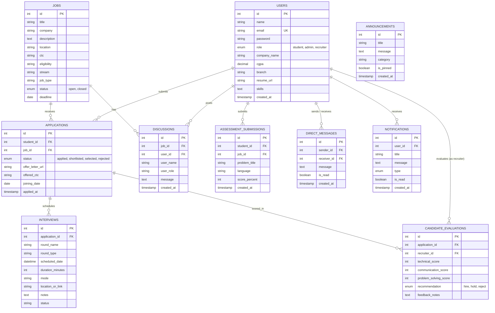
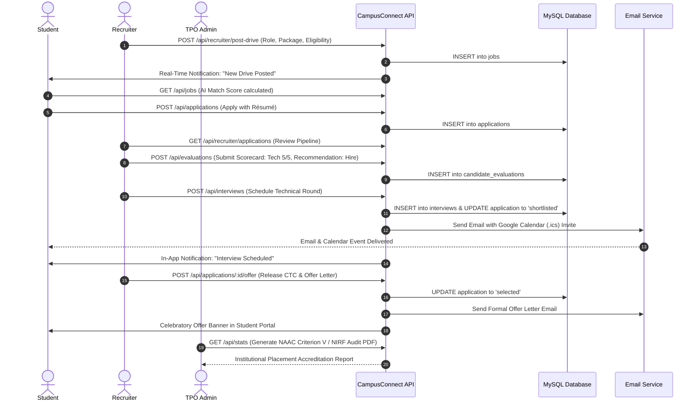

# 📐 CampusConnect — System Architecture & Workflow Diagrams

---

## 1. High-Level System Architecture

```mermaid
flowchart TD
    subgraph Client_Layer ["Client Layer (Browser)"]
        UI_Student["Student Portal (Vite + React)"]
        UI_Admin["TPO Admin Dashboard"]
        UI_Recruiter["Corporate Recruiter Portal"]
    end

    subgraph Gateway ["Reverse Proxy & Web Server"]
        Nginx["Nginx / Vite Dev Server (Port 5173 / 80)"]
    end

    subgraph Backend_Layer ["Application Layer (Node.js & Express - Port 5000)"]
        Auth_Middleware["JWT Auth & Role Guard Middleware"]
        Router_Auth["Auth Router (/api/auth)"]
        Router_Jobs["Jobs Router (/api/jobs)"]
        Router_Apps["Applications Router (/api/applications)"]
        Router_Profile["Profile & Uploads (/api/profile)"]
        Router_Interviews["Interviews Router (/api/interviews)"]
        Router_Eval["Evaluations Router (/api/evaluations)"]
        Router_Recruiter["Recruiter Router (/api/recruiter)"]
        Router_Forum["Forum Router (/api/forum)"]
        Router_Assessment["Coding Assessment (/api/assessment)"]
        Router_Messages["Direct Chat (/api/messages)"]
        Router_Assistant["CampusBot AI (/api/assistant)"]
        Router_Stats["Stats & NIRF Router (/api/stats)"]
        Email_Service["Nodemailer & .ics Calendar Engine"]
    end

    subgraph Storage_Layer ["Data Persistence Layer"]
        DB[(MySQL 8.4 Database - Port 3306)]
        FileStore["Local File Storage (/backend/uploads/resumes)"]
    end

    UI_Student --> Nginx
    UI_Admin --> Nginx
    UI_Recruiter --> Nginx
    Nginx --> Auth_Middleware
    Auth_Middleware --> Router_Auth
    Auth_Middleware --> Router_Jobs
    Auth_Middleware --> Router_Apps
    Auth_Middleware --> Router_Profile
    Auth_Middleware --> Router_Interviews
    Auth_Middleware --> Router_Eval
    Auth_Middleware --> Router_Recruiter
    Auth_Middleware --> Router_Forum
    Auth_Middleware --> Router_Assessment
    Auth_Middleware --> Router_Messages
    Auth_Middleware --> Router_Assistant
    Auth_Middleware --> Router_Stats
    Router_Interviews --> Email_Service
    Router_Apps --> Email_Service
    Router_Jobs --> DB
    Router_Apps --> DB
    Router_Profile --> DB
    Router_Eval --> DB
    Router_Recruiter --> DB
    Router_Forum --> DB
    Router_Assessment --> DB
    Router_Messages --> DB
    Router_Stats --> DB
    Router_Profile --> FileStore
```

---

## 2. Entity-Relationship (ER) Diagram

---

## 3. End-to-End Application & Interview Flow

