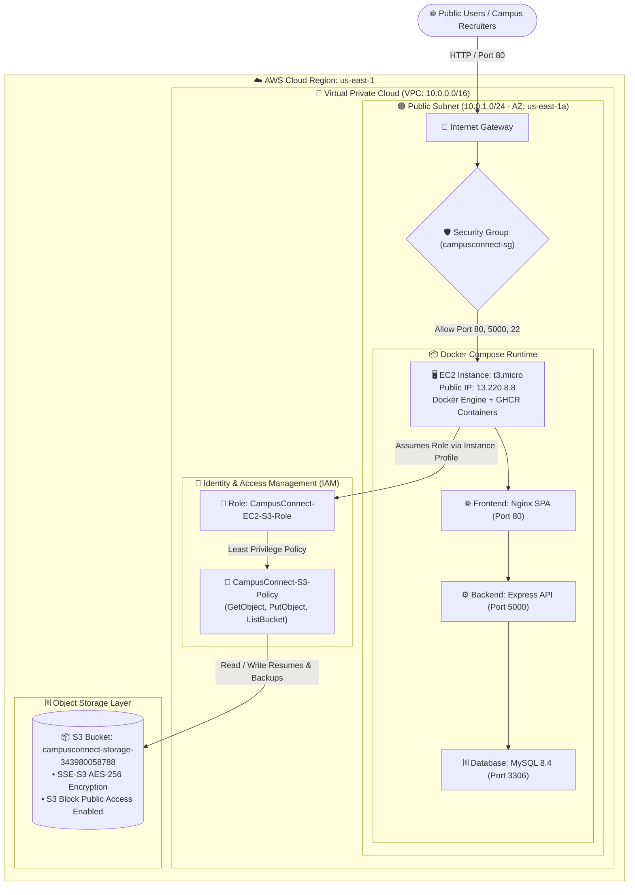

# Phase 4: Cloud Computing Architecture & Deployment (AWS & GCP)

> **College Viva Defense Focus**: 3-Tier Enterprise Cloud Architecture, Virtual Machines (EC2), Virtual Private Cloud (VPC), Security Groups, Cloud Storage (S3), and Identity & Access Management (IAM).

---

## 1. Live Provisioned AWS Cloud Infrastructure Catalog

All resources are actively provisioned under **AWS Free Tier (100% Zero Cost)**:

| Category | AWS Resource | Resource Identifier / Value | Security / Configuration |
| :--- | :--- | :--- | :--- |
| **Account** | AWS Account ID | `343980058788` | Active Root Account |
| **Region** | AWS Region | `us-east-1` (N. Virginia) | Availability Zone: `us-east-1a` |
| **Compute** | EC2 Instance | `i-09a7f5fbff3affe55` | `t3.micro` (2 vCPUs, 1 GiB RAM - Free Tier) |
| **Public IP** | IPv4 Public Address | **`13.220.8.8`** | Direct Internet Access on Port 80 & 5000 |
| **Public DNS** | Public DNS Hostname | `ec2-13-220-8-8.compute-1.amazonaws.com` | AWS Dynamic DNS |
| **Firewall** | Security Group | `sg-0ad375022db966613` (`campusconnect-sg`) | Ports 80 (HTTP), 5000 (API), 22 (SSH) |
| **Key Pair** | SSH Key Pair | `campusconnect-key` | Private key stored in `infra/keys/` |
| **Storage** | S3 Bucket | `s3://campusconnect-storage-343980058788` | SSE-AES256 Encrypted, Public Access Blocked |
| **IAM** | Instance Profile | `CampusConnect-EC2-Profile` | Linked to Role `CampusConnect-EC2-S3-Role` |

---

## 2. 3-Tier Enterprise Cloud Architecture Diagram



---

## 3. Core Cloud Pillars Breakdown

### Pillar 1: Compute (EC2 / Virtual Machines)
- **Instance Type**: `t3.micro` powered by high-frequency Intel Xeon Scalable processors with AWS Nitro System.
- **Why `t3.micro` over `t2.micro`**: Modern AWS regions designate `t3.micro` as the standard Free Tier tier, offering 2 vCPUs (bursting enabled) compared to `t2.micro`'s single core.
- **User Data (Cloud-Init)**: Automatically scripts the instance boot process: updates packages, installs Docker engine, pulls images from GitHub Container Registry (Phase 3), and launches the stack with zero human interaction.
- **SSH Key Pair (`campusconnect-key`)**: Uses RSA 2048-bit cryptographic key authentication. The private key (`.pem`) is protected in `.gitignore` to prevent secret leakage.

### Pillar 2: Storage & Networking (VPC, Subnets, S3)
- **VPC (Virtual Private Cloud)**: An isolated virtual network dedicated to CampusConnect resources.
- **Subnets**: Subnets divide the VPC CIDR block into isolated network segments across multiple Availability Zones for fault tolerance.
- **Internet Gateway (IGW)**: Horizontally scaled, redundant VPC component that enables communication between instances in the public subnet and the Internet.
- **S3 Object Storage**:
  - Global namespace: `campusconnect-storage-343980058788`.
  - **Server-Side Encryption (SSE-S3)**: All candidate resumes and database dumps are automatically encrypted at rest with AES-256 keys managed by Amazon.
  - **Block Public Access**: Hardened against accidental data leaks; files can only be accessed via IAM authentication or temporary Pre-signed URLs.

### Pillar 3: Security & IAM (Identity & Access Management)
- **Principle of Least Privilege (PoLP)**: Rather than granting `AdministratorAccess` or wildcard `s3:*`, our IAM policy restricts access exclusively to `campusconnect-storage-343980058788/*` and only for `s3:GetObject`, `s3:PutObject`, and `s3:DeleteObject`.
- **Instance Profile (Zero Hardcoded Secrets)**: The EC2 instance retrieves temporary rotating security credentials from the AWS Instance Metadata Service (IMDSv2) via the attached IAM Role, eliminating the need to store AWS Access Keys or Secrets on disk.

---

## 4. Multi-Cloud Service Comparison Matrix (AWS vs GCP)

Examiner may ask: *"Agar yahi architecture GCP par banana hota toh kaunse services use hote?"*

| Architectural Layer | AWS Solution (Implemented) | GCP Equivalent Solution |
| :--- | :--- | :--- |
| **Virtual Machine** | Amazon EC2 (`t3.micro`) | Google Compute Engine (`e2-micro`) |
| **Virtual Network** | Amazon VPC + Subnets + IGW | VPC Network + Subnets + Cloud Router |
| **Firewall Rules** | AWS Security Groups (`campusconnect-sg`) | VPC Firewall Rules (`allow-http`, `allow-ssh`) |
| **Object Storage** | Amazon S3 (`campusconnect-storage`) | Google Cloud Storage (GCS Bucket) |
| **Access Control** | AWS IAM Roles & Instance Profiles | GCP IAM Roles & Service Accounts |
| **Container Registry** | AWS ECR / GitHub Container Registry | Google Artifact Registry |
| **Infrastructure as Code** | Terraform AWS Provider | Terraform Google Provider |

---

## 5. Live Examiner Demonstration Script

Follow this step-by-step procedure to show your cloud deployment to the examiner:

### Step 1: Open AWS Management Console
1. Log in to [https://console.aws.amazon.com/](https://console.aws.amazon.com/) in region **us-east-1**.
2. Navigate to **EC2 > Instances**:
   - Point out instance **`CampusConnect-Production-Server`** (`i-09a7f5fbff3affe55`).
   - Show that the state is **`Running`** and instance type is **`t3.micro`**.
   - Show the Public IPv4 address: **`13.220.8.8`**.

### Step 2: Show Security Groups (Firewalls)
1. On the EC2 instance details, click on the **Security** tab.
2. Click on **`campusconnect-sg`**:
   - Show inbound rules: Port 80 (HTTP), Port 5000 (API), Port 22 (SSH).
   - Explain that all other ports (like MySQL 3306) are blocked from the outside world.

### Step 3: Show IAM Role & Security Best Practice
1. Show that the instance has IAM Role **`CampusConnect-EC2-S3-Role`** attached.
2. Explain the **Principle of Least Privilege**:
   > *"Sir/Ma'am, humne server par koi AWS access key ya secret key hardcode nahi ki hai. Server IAM instance profile ke through temporary rotating credentials use karta hai."*

### Step 4: Show S3 Object Storage
1. Navigate to **Amazon S3**:
   - Show bucket **`campusconnect-storage-343980058788`**.
   - Show that **Block all public access** is ON.
   - Show that **Default encryption (SSE-S3 AES-256)** is enabled.

---

## 6. Top 8 Viva Questions & Answers (Examiner Defense)

### Q1: What is the difference between a Security Group and a Network ACL (NACL)?
> **Answer**:
> - **Security Group**: State-ful firewall operating at the **EC2 instance level**. If an inbound request is permitted (e.g. port 80), the return response traffic is automatically allowed regardless of outbound rules. It supports allow rules only.
> - **NACL (Network Access Control List)**: State-less firewall operating at the **subnet level**. Inbound and outbound traffic must be explicitly allowed. It processes rules in numerical order and supports both ALLOW and DENY rules.

---

### Q2: Why did you use an IAM Role instead of storing AWS Access Keys on the EC2 instance?
> **Answer**:
> Storing hardcoded AWS Access Keys (`AWS_ACCESS_KEY_ID` / `AWS_SECRET_ACCESS_KEY`) in `.env` files or config is a major security vulnerability (credential leakage risk).
> By attaching an **IAM Instance Profile**, the EC2 instance automatically fetches temporary, rotating credentials from the AWS Instance Metadata Service (IMDSv2). This adheres to the **Principle of Least Privilege (PoLP)** and DevSecOps best practices.

---

### Q3: What is the difference between Public Subnet and Private Subnet in a VPC?
> **Answer**:
> - **Public Subnet**: Its route table has an explicit route pointing to an **Internet Gateway (IGW)** (`0.0.0.0/0 -> igw-xxxx`). Instances inside receive public IP addresses and can be accessed directly from the Internet.
> - **Private Subnet**: Its route table does **not** have an Internet Gateway route. It communicates with the outside world only outbound via a **NAT Gateway** located in the public subnet. Databases and backend microservices are placed in private subnets for defense-in-depth security.

---

### Q4: What is Server-Side Encryption (SSE-S3) and why is it important for CampusConnect?
> **Answer**:
> In CampusConnect, student resumes contain Personally Identifiable Information (PII) like phone numbers, addresses, and grades. **SSE-S3** encrypts each object using a unique AES-256 key managed by AWS before saving it to disk, and decrypts it on read for authorized callers. This fulfills data protection compliance and prevents physical disk compromise.

---

### Q5: What is Cloud-Init / User Data in EC2?
> **Answer**:
> User Data is a bootstrap shell script that executes automatically with root privileges during the very first boot of the EC2 instance. In our architecture, it automates installing Docker, pulling our multi-stage images from GitHub Container Registry (Phase 3), and starting the containers without manual SSH intervention.

---

### Q6: What is the difference between Horizontal Scaling and Vertical Scaling in Cloud?
> **Answer**:
> - **Vertical Scaling (Scale Up)**: Increasing the computing power of a single instance (e.g. upgrading `t3.micro` to `t3.large`). It has hardware ceilings and causes downtime during resizing.
> - **Horizontal Scaling (Scale Out)**: Adding more homogeneous instances behind an Application Load Balancer (ALB) via an **Auto Scaling Group (ASG)** based on CPU/traffic metrics. This provides zero downtime and high availability.

---

### Q7: What is Infrastructure as Code (IaC) and why did you create Terraform files?
> **Answer**:
> Infrastructure as Code allows managing and provisioning cloud resources through machine-readable definition files rather than manual point-and-click in the cloud console.
> We created **Terraform manifests (`infra/aws/terraform/`)** because Terraform is vendor-neutral, declarative, provides plan previews (`terraform plan`), and allows recreating the entire infrastructure in a single command across multiple environments (Dev, Staging, Prod).

---

### Q8: How can we connect to the EC2 instance securely?
> **Answer**:
> Using the generated cryptographic private key:
> ```bash
> chmod 400 infra/keys/campusconnect-key.pem
> ssh -i infra/keys/campusconnect-key.pem ec2-user@13.220.8.8
> ```
> Alternatively, for enhanced security without opening port 22 to the public internet, **AWS Systems Manager (SSM) Session Manager** can be used to open a browser-based shell session via an IAM role.
