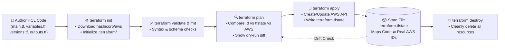

# Phase 5: Infrastructure as Code (IaC) with Terraform

> **Industry-Standard Cloud Provisioning**: Replacing manual Cloud Console clicking ("ClickOps") with declarative, version-controlled, reproducible HCL code (`.tf`), State Management (`terraform.tfstate`), and Lifecycle Automation.

---

## 1. ClickOps vs Infrastructure as Code (Why Terraform?)

| Feature | Manual Cloud Console (ClickOps) | Terraform (Infrastructure as Code) |
| :--- | :--- | :--- |
| **Reproducibility** | Human error prone; hard to recreate Dev/Staging/Prod identically | **100% Identical** environments from one `.tf` codebase |
| **Version Control** | No history of who changed a firewall port or VM size | Full **Git audit trail** (`git blame`, PR reviews) |
| **Preview Before Change** | Clicking "Apply" changes live infrastructure immediately | **`terraform plan`** previews exact `+ add / ~ change / - destroy` before applying |
| **Cleanup / Teardown** | Easy to forget orphaned EBS volumes, IPs, or security groups | Single **`terraform destroy`** safely removes everything tracked in state |
| **Cloud Agnostic** | Locked to one portal UI | Supports AWS, GCP, Azure, GitHub, Docker via Providers |

---

## 2. Terraform Execution Lifecycle & Architecture



---

## 3. Project Terraform File Structure (`infra/aws/terraform/`)

Following HashiCorp's official module & file organization standards:

| File | Responsibility | Key Constructs Used |
| :--- | :--- | :--- |
| [`versions.tf`](../infra/aws/terraform/versions.tf) | Pins Terraform CLI (`>= 1.5.0`) & AWS Provider (`~> 5.0`), sets global `default_tags` | `terraform {}`, `provider "aws" {}` |
| [`locals.tf`](../infra/aws/terraform/locals.tf) | Centralized computed metadata & common tags across all cloud resources | `locals {}` |
| [`variables.tf`](../infra/aws/terraform/variables.tf) | Typed input variables with strict `validation` guardrails (e.g. Free Tier only) | `variable {}`, `validation {}` |
| [`main.tf`](../infra/aws/terraform/main.tf) | Core resource declarations: Data sources, S3, IAM Role/Policy, Security Group, EC2 | `data {}`, `resource {}`, `lifecycle {}` |
| [`outputs.tf`](../infra/aws/terraform/outputs.tf) | Exports public IP, live URL, SSH command, ARNs after execution | `output {}` |
| [`terraform.tfvars.example`](../infra/aws/terraform/terraform.tfvars.example) | Template variable values for multi-environment configuration | `key = value` |
| [`backend.tf.example`](../infra/aws/terraform/backend.tf.example) | Blueprint for Remote State Storage & Locking in Amazon S3 | `backend "s3" {}` |

---

## 4. Deep Dive: Understanding `terraform.tfstate` (State File)

Examiners **always** ask about `terraform.tfstate`. Here is how it works in CampusConnect:

1. **What is `terraform.tfstate`?**
   - It is a JSON database file mapping your Terraform resource names (e.g., `aws_instance.app_server`) to real cloud resource IDs (e.g., `i-09a7f5fbff3affe55`).
2. **Why is State Necessary?**
   - **Performance & Dependency Graph**: Terraform knows which resources depend on others (e.g., EC2 depends on Security Group & IAM Instance Profile) and destroys/updates them in the right order.
   - **Drift Detection**: When you run `terraform plan`, Terraform refreshes state against the live AWS API to detect if someone manually modified a firewall rule in the console!
3. **Why is `terraform.tfstate` in `.gitignore`?**
   - State files can contain **sensitive metadata** (keys, database passwords, account IDs, internal IPs). Never commit `terraform.tfstate` to GitHub.
   - In production teams, we use a **Remote Backend** (like S3 with locking — see `backend.tf.example`) so multiple engineers never corrupt state simultaneously.

---

## 5. Essential Terraform Commands Reference

```bash
cd infra/aws/terraform

# 1. Format code cleanly according to HashiCorp style standards
terraform fmt

# 2. Initialize working directory & download AWS provider plugins
terraform init

# 3. Validate HCL syntax and variable references offline
terraform validate

# 4. Dry-run: Preview exact changes without modifying AWS
terraform plan

# 5. Provision / sync infrastructure on AWS
terraform apply

# 6. Inspect all live resources currently tracked in terraform.tfstate
terraform state list

# 7. Display exported endpoints (Public IP, App URL, SSH command)
terraform output

# 8. Import an existing manually-created AWS resource into Terraform management
terraform import aws_instance.app_server i-09a7f5fbff3affe55

# 9. Safely tear down all managed infrastructure (Zero orphaned resources)
terraform destroy
```

Or use our wrapper script from the project root:
```bash
./scripts/terraform_manage.sh status
./scripts/terraform_manage.sh plan
```

---

## 6. Top 8 Terraform Viva Questions & Answers

### Q1: What is Infrastructure as Code (IaC) and how is Terraform different from Ansible?
> **Answer**:
> - **Terraform** is a **Provisioning / Orchestration tool** (Declarative): It creates, updates, and destroys the underlying cloud infrastructure itself (VPCs, Subnets, EC2 VMs, S3 buckets, Load Balancers) and tracks them using state (`terraform.tfstate`).
> - **Ansible** is a **Configuration Management tool**: Once the server exists, Ansible connects over SSH to configure OS settings, copy files, and install software packages.
> - *In short*: Terraform builds the house (infrastructure); Ansible furnishes the house (OS & app setup).

---

### Q2: Explain `terraform init`, `terraform plan`, and `terraform apply`.
> **Answer**:
> - **`terraform init`**: Initializes the project directory, configures the backend (local or S3), and downloads required provider binaries (like `hashicorp/aws`).
> - **`terraform plan`**: Performs a dry run. It compares your `.tf` files, `terraform.tfstate`, and live AWS APIs, then outputs an execution plan showing `+ create`, `~ update in-place`, or `- destroy` without making any actual changes.
> - **`terraform apply`**: Executes the execution plan against the cloud provider APIs and updates `terraform.tfstate` with the new real-world resource attributes.

---

### Q3: What happens if you delete `terraform.tfstate`?
> **Answer**:
> Your live AWS servers will **keep running** (deleting the state file does not delete cloud resources), **BUT** Terraform loses memory of them. On the next `terraform apply`, Terraform will assume nothing exists and attempt to create duplicate resources, failing with "Already Exists" conflicts. You would have to recover them one by one using `terraform import`.

---

### Q4: What is the difference between a `resource` block and a `data` block?
> **Answer**:
> - **`resource` block**: Tells Terraform to **create, own, and manage** the lifecycle (CRUD) of an infrastructure object (e.g., `resource "aws_instance" "app_server"`).
> - **`data` block**: **Read-only** query to fetch information about existing infrastructure or dynamic environment facts (e.g., `data "aws_caller_identity" "current"` or fetching the latest Amazon Linux AMI ID) without managing its lifecycle.

---

### Q5: How do you prevent accidental deletion or downtime of a production server in Terraform?
> **Answer**:
> Using **`lifecycle` meta-arguments**! For example:
> - `lifecycle { prevent_destroy = true }` blocks `terraform destroy` on critical databases/S3 buckets.
> - `lifecycle { ignore_changes = [user_data] }` (used in CampusConnect's `main.tf`) prevents Terraform from forcefully destroying and recreating a running EC2 server just because a startup script comment was edited.
> - `create_before_destroy = true` spins up a replacement resource before terminating the old one for zero downtime.

---

### Q6: What is State Locking and how do teams prevent concurrent Terraform conflicts?
> **Answer**:
> If two developers run `terraform apply` at the exact same moment on a shared local file, `terraform.tfstate` gets corrupted. Teams solve this using a **Remote S3 Backend** with **State Locking** (via S3 lockfile `use_lockfile = true` in Terraform 1.10+ or DynamoDB table). While Dev A is applying, the state is locked so Dev B waits safely until Dev A finishes.

---

### Q7: What is `terraform import` and when did we use it in CampusConnect?
> **Answer**:
> `terraform import` brings pre-existing cloud infrastructure (created earlier via AWS Console or AWS CLI) under Terraform management by recording its real AWS ID into `terraform.tfstate`. In CampusConnect, we imported our live `i-09a7f5fbff3affe55` EC2 instance, S3 bucket, Security Group, and IAM Role into `terraform.tfstate` so Terraform can manage them declaratively with zero drift (`No changes`).

---

### Q8: How do `variables.tf`, `locals.tf`, and `outputs.tf` keep HCL code clean?
> **Answer**:
> - **`variables.tf`**: Externalizes inputs (like region, instance type) with type safety and `validation` guardrails (we restricted instances strictly to Free Tier `micro` types!).
> - **`locals.tf`**: Follows DRY (Don't Repeat Yourself) principles for shared tags and computed expressions.
> - **`outputs.tf`**: Surfaces critical dynamically assigned values (like the EC2 public IP and SSH command) after `apply` finishes.
