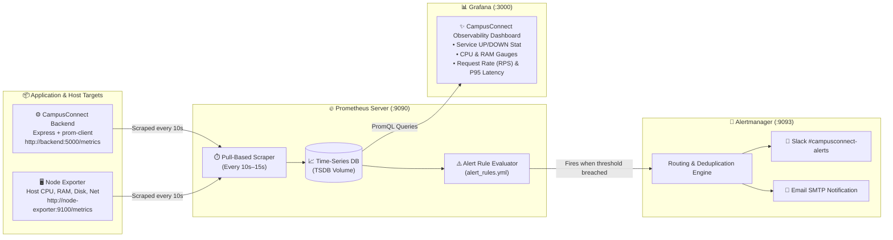

# Phase 7: Monitoring, Observability & Alerting (Prometheus + Grafana)

> **Production SRE Observability**: Real-time Infrastructure & Application Metrics Instrumentation (`/metrics`), Time-Series Scraping (`Prometheus`), Auto-Provisioned Dashboards (`Grafana`), and Automated Outage Alerts (`Alertmanager` -> Slack / Email).

---

## 1. Observability Architecture Diagram



---

## 2. Live Service Endpoints (Running on Docker Desktop)

| Service | Container Name | Port / URL | Purpose |
| :--- | :--- | :--- | :--- |
| **Grafana Dashboard** | `campusconnect-grafana` | [http://localhost:3000](http://localhost:3000) | Pre-built visual dashboard (`admin` / `admin` or direct view) |
| **Prometheus UI** | `campusconnect-prometheus` | [http://localhost:9090](http://localhost:9090) | PromQL queries, scrape targets (`/targets`), alert rules (`/alerts`) |
| **Alertmanager UI** | `campusconnect-alertmanager` | [http://localhost:9093](http://localhost:9093) | Active alert grouping, silencing, Slack/Email receivers |
| **Backend Metrics** | `campusconnect-backend` | [http://localhost:5001/metrics](http://localhost:5001/metrics) | Express `prom-client` runtime + custom HTTP counters/histograms |
| **Node Exporter** | `campusconnect-node-exporter` | [http://localhost:9100/metrics](http://localhost:9100/metrics) | Host CPU, Memory, Filesystem & Network counters |

---

## 3. Custom Application Metrics (`backend/middleware/metrics.js`)

Using the official Prometheus Node.js client (`prom-client`), CampusConnect exposes both runtime and business-critical metrics:

| Metric Name | Type | Description & Labels |
| :--- | :--- | :--- |
| `campusconnect_http_requests_total` | **Counter** | Total HTTP requests labeled by `method`, `route`, `status_code` (tracks traffic & 5xx errors) |
| `campusconnect_http_request_duration_seconds` | **Histogram** | Latency buckets (`5ms` to `5s`) enabling exact **P95 / P99** response time calculation |
| `campusconnect_process_resident_memory_bytes` | **Gauge** | Real-time Express server RSS RAM usage |
| `campusconnect_nodejs_heap_size_used_bytes` | **Gauge** | V8 JavaScript heap allocation (detects memory leaks early) |
| `up{job="campusconnect-backend"}` | **Gauge** | `1` when backend `/metrics` responds, `0` immediately when server crashes |

---

## 4. Configured Alerting Rules (`monitoring/prometheus/alert_rules.yml`)

| Alert Name | Condition (PromQL) | Duration (`for`) | Severity |
| :--- | :--- | :--- | :--- |
| **`CampusConnectBackendDown`** | `up{job="campusconnect-backend"} == 0` | `15s` | **Critical** |
| **`HighHostCPUUsage`** | Host CPU > `80%` | `1m` | Warning |
| **`HighHostMemoryUsage`** | Host RAM > `85%` | `1m` | Warning |
| **`HighAPILatencyP95`** | P95 API Response Time > `1.0s` | `1m` | Warning |
| **`HighHTTP5xxErrorRate`** | HTTP 5xx Error Rate > `5%` | `1m` | **Critical** |

---

## 5. Essential PromQL Cheat Sheet (For Viva Demo)

Run these directly in Prometheus ([http://localhost:9090/graph](http://localhost:9090/graph)):

```promql
# 1. Check Backend Health (1 = Up, 0 = Down)
up{job="campusconnect-backend"}

# 2. Requests Per Second (RPS) across routes
sum by (route, status_code) (rate(campusconnect_http_requests_total[1m]))

# 3. 95th Percentile API Latency in milliseconds
histogram_quantile(0.95, sum(rate(campusconnect_http_request_duration_seconds_bucket[5m])) by (le)) * 1000

# 4. Host CPU Utilization %
100 - (avg(rate(node_cpu_seconds_total{mode="idle"}[1m])) * 100)

# 5. Host RAM Usage %
(node_memory_MemTotal_bytes - node_memory_MemAvailable_bytes) / node_memory_MemTotal_bytes * 100
```

---

## 6. Live Examiner Demo Script (Including Alert Trigger!)

### Step 1: Show Grafana Auto-Provisioned Visual Dashboard
1. Open [http://localhost:3000](http://localhost:3000) in the browser.
2. Go to **Dashboards -> CampusConnect -> CampusConnect Observability & Infrastructure**.
3. Point out real-time **CPU %**, **RAM %**, **Service Status (`ONLINE (UP)`)**, **Heap Memory**, and **API Latency P95**.

### Step 2: Generate Traffic & Watch Graphs Spike
Hit the API a few times (or browse CampusConnect) and refresh Grafana (auto-refreshes every `5s`) to show Request Rate climbing in real time!

### Step 3: Trigger a Live Outage Alert (`CampusConnectBackendDown`)
1. Open Prometheus Alerts UI: [http://localhost:9090/alerts](http://localhost:9090/alerts).
2. Stop the backend container (`docker stop campusconnect-backend`) or run `./scripts/test_alert.sh`.
3. Watch **`CampusConnectBackendDown`** transition live from **Green (`Inactive`)** → **Yellow (`Pending`)** → **Red (`FIRING`)** within 15 seconds, then route into Alertmanager ([http://localhost:9093](http://localhost:9093))!
4. Run `docker start campusconnect-backend` and show the alert automatically resolving back to green.

---

## 7. Top 8 Monitoring & Observability Viva Questions & Answers

### Q1: What is the difference between Monitoring and Observability?
> **Answer**:
> - **Monitoring** tells you **whether** a system is healthy based on predefined dashboards and thresholds (e.g., "CPU is 85%" or "Server is DOWN").
> - **Observability** goes deeper using the **Three Pillars (Metrics, Logs, Traces)** so you can ask arbitrary questions about *why* an unknown failure happened (e.g., correlating a P95 latency spike on `/api/jobs` directly to a slow SQL query or memory leak).

---

### Q2: How does Prometheus collect metrics — Pull or Push model? Why?
> **Answer**:
> Prometheus uses a **Pull (scraping) model** over HTTP (`GET /metrics` every 10–15 seconds).
> **Why Pull is superior**:
> 1. Prometheus immediately detects if a target crashes (`up == 0`) instead of silently missing push packets.
> 2. Targets stay simple — they don't need monitoring server addresses hardcoded.
> 3. Prevent metric storms from crashing the monitoring server during traffic spikes.
> *(For short-lived batch/cron jobs, Prometheus offers the optional Pushgateway).*

---

### Q3: What are the 4 metric types in Prometheus?
> **Answer**:
> 1. **Counter**: Strictly cumulative, monotonically increasing value (resets only on restart) — e.g., `campusconnect_http_requests_total`.
> 2. **Gauge**: Snapshot value that goes both up and down — e.g., CPU %, RAM bytes, active connections.
> 3. **Histogram**: Samples observations (like request latencies) into configurable buckets (`le="0.1"`, `le="0.5"`) so Prometheus can compute server-side **percentiles (P95/P99)** across multiple replicas.
> 4. **Summary**: Computes quantiles on the client side (cannot easily aggregate across distributed Pods like Histograms can).

---

### Q4: Why do we use Histograms (`histogram_quantile`) instead of average latency?
> **Answer**:
> Averages hide tail-latency pain! If 95 users experience `20ms` latency and 5 users experience `5,000ms` timeouts, the average still looks deceptively low (`269ms`). **P95 / P99 Histogram quantiles** expose worst-case user experiences cleanly and can be aggregated mathematically across scaled Kubernetes Pods.

---

### Q5: Explain the 3 states of a Prometheus Alert (`Inactive`, `Pending`, `Firing`).
> **Answer**:
> - **Inactive (Green)**: Alert condition evaluates to false (system healthy).
> - **Pending (Yellow)**: Condition became true, waiting for the `for:` duration (e.g. `for: 15s` or `1m`) to avoid false-positive alert flapping on transient 1-second glitches.
> - **Firing (Red)**: Condition remained true continuously for the entire `for:` window; Prometheus dispatches the alert payload to **Alertmanager** to notify Slack/Email.

---

### Q6: What is Alertmanager's role instead of Prometheus sending Slack/Email directly?
> **Answer**:
> Alertmanager handles **Deduplication, Grouping, Inhibition, and Silencing**. If 100 Pods fail simultaneously because the MySQL database went down, Alertmanager groups those 100 identical alerts into a single clean Slack/Email summary instead of flooding an engineer's inbox with 100 spam messages ("alert fatigue").

---

### Q7: What is `node-exporter` vs `prom-client`?
> **Answer**:
> - **`node-exporter`** collects **Operating System / Hardware-level metrics** (Linux CPU idle/user time, total/free RAM, Disk I/O, Network bytes).
> - **`prom-client`** lives **inside our Node.js Express application**, exposing **application-level & runtime metrics** (HTTP request counts per API route, latency histograms, V8 heap RAM, event loop lag). Combining both gives complete full-stack visibility!

---

### Q8: How is our Grafana setup automated using Infrastructure as Code?
> **Answer**:
> Instead of manually clicking UI buttons to create datasources and drag-and-drop charts, we used **Grafana Provisioning** (`monitoring/grafana/provisioning/`): YAML config files automatically attach Prometheus as default datasource (`uid: Prometheus`) and mount our dashboard JSON on container startup, making the observability dashboard 100% reproducible across any server.
